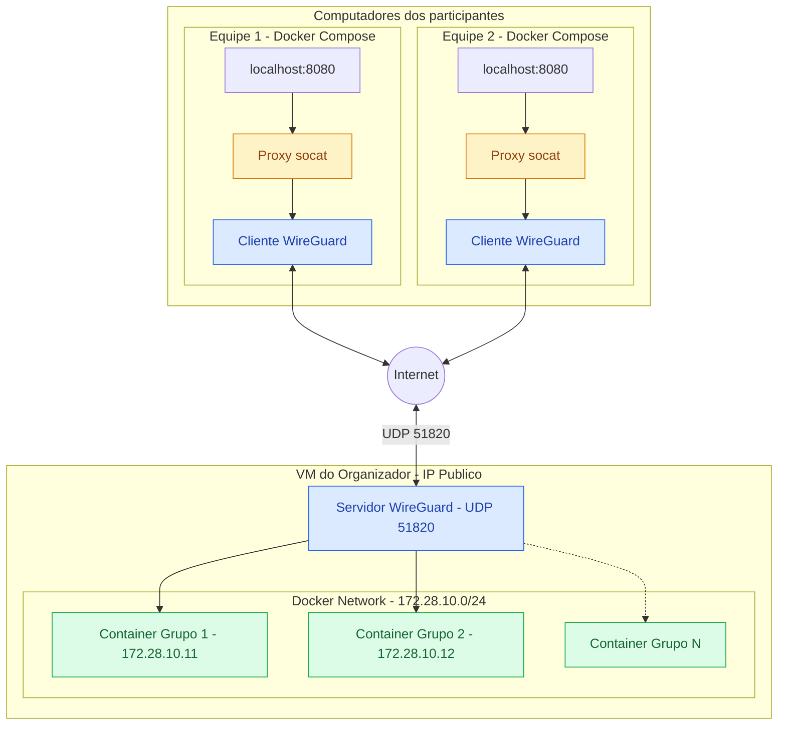

## Dentro da VM
1. git clone https://github.com/eduardoSantiag0/hackaton-setup
1. chmod +x keygen.sh
1. chmod +x configurar-grupos.sh
1. ``./admin/configurar-grupos.sh <IP DA MAQUINA> <NUMERO GRUPOS> 51820``
1. sudo docker compose up -d
1. Enviar email para os participantes que ficarão na pasta admin/emails

### configurar-grupos.sh gera: 
- Chave privada do WireGuard em admin/wg0.config.
- Gera a chave publica a partir da priv
- Gera um par de chaves para cada grupo. As privadas são armazenadas em admin/chaves-privadas/grupoN-privkey.txt.
- Adiciona uma seção [Peer] ao admin/wg0.config para cada grupo, contendo sua chave pública e seu IP VPN autorizado.
Cada grupo executa: 
- Atribui um endereço a cada grupo
- Calcula o IP correspondente de cada container (enviado como GRUPO_CONTAINER_IP)
- Gera admin/emails/grupoN.txt, contendo instruções e as seis variáveis necessárias para a conexão: PRIVATE_KEY, ADDRESS, SERVER_PUBLIC_KEY, ENDPOINT, ALLOWED_IPS e GRUPO_CONTAINER_IP

### Cada grupo deve:
- Copiar o bloco do email para grupo-template/.env
- Executar ./gerar-conf.sh (gera o wg0.conf a partir do .env)
- Executar `docker compose up -d` (assim não precisa instalar o WireGuard na máquina deles)
- Acessar a aplicação do grupo em http://localhost:8080 (a app do grupo
  precisa escutar na porta 8080 dentro do container deles, convenção fixa)

Link para template dos pariticpantes: 
- [https://github.com/eduardoSantiag0/hackaton-participante/](https://github.com/eduardoSantiag0/hackaton-participante)

### Arquitetura da infraestrutura

**Template dos participantes:**
[hackaton-participante](https://github.com/eduardoSantiag0/hackaton-participante/)

